<div align="center">

<!-- Header banner -->


<!-- Typing subtitle -->
<a href="https://git.io/typing-svg">
  
</a>

<br><br>

<!-- Social badges -->
<a href="https://github.com/Emzbrown"></a>
<a href="mailto:ChinasaEmmanuel2009@gmail.com"></a>
<a href="https://linkedin.com/"></a>

<br>

<!-- Live counters -->


</div>

---

### 👨‍💻 About Me

```python
class ChinasaEmmanuel:
    roles      = ["Software Developer", "Backend Architect", "Competitive Programmer"]
    stack      = ["Python", "Django", "JavaScript", "HTML5", "CSS3", "Bootstrap"]
    practising = ["Sliding Window", "Two Pointers", "Binary Search"]
    exploring  = ["React.js", "Advanced Vanilla JS", "PHP"]

    def mission(self) -> str:
        return "Build scalable backend systems, one algorithm at a time."
```

---

### 🧪 Periodic Table of Tech Stack

<div align="center">
  
</div>

---

### 📌 Featured Project

<div align="center">
  <!-- Change `repo=` to any repository you want to pin here -->
  <a href="https://github.com/Emzbrown/emzy-blog">
    
  </a>
</div>

---

### 📊 GitHub Analytics

<div align="center">
  
  
  <br>
  
</div>

<details>
<summary><b>🏆 Trophies &amp; contribution graph</b></summary>
<br>
<div align="center">
  
  <br>
  
</div>
</details>

---

<div align="center">

<!-- Contribution snake: generated by .github/workflows/snake.yml -->
<picture>
  <source media="(prefers-color-scheme: dark)" srcset="https://raw.githubusercontent.com/Emzbrown/Emzbrown/output/github-contribution-grid-snake-dark.svg" />
  <source media="(prefers-color-scheme: light)" srcset="https://raw.githubusercontent.com/Emzbrown/Emzbrown/output/github-contribution-grid-snake.svg" />
  
</picture>

<br>


</div>
